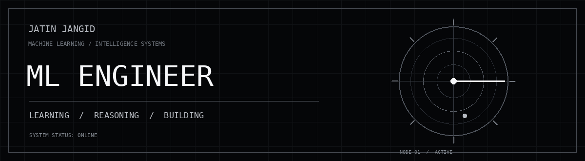
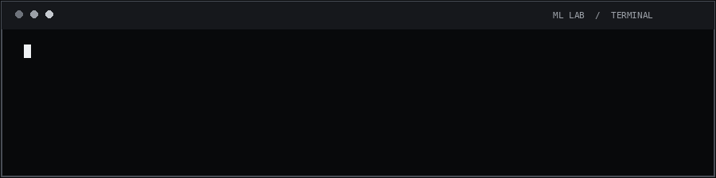

JATIN JANGID   /   INDIA   /   MCA 

GitHub  ·  LinkedIn  ·  Email

01 — PROFILE
I'm Jatin, an ML Engineer interested in building intelligent systems that move beyond experiments and into useful software.

I work across the machine learning lifecycle: understanding the problem, preparing data, developing and evaluating models, then engineering the APIs and product experience around them.

My interests include machine learning, deep learning, LLM applications, retrieval systems, computer vision and multimodal AI.
Curiosity is the input. Engineering is the output.

02 — TECHNICAL DOMAINS
DOMAIN	CURRENT INTERESTS
Machine Learning	Model development · Feature engineering · Evaluation · Recommendation systems
Deep Learning	Neural networks · Transformers · Representation learning
Generative AI	LLMs · RAG · Embeddings · Agent workflows
Computer Vision	Image understanding · Object detection · Vision-language models
ML Engineering	FastAPI · Vector search · Docker · Deployment · Data pipelines

PYTHON   PYTORCH   TENSORFLOW   SCIKIT-LEARN
OPENCV   FASTAPI   DOCKER   POSTGRESQL
AWS   AZURE   GIT   LINUX

Also working with: LangChain · LangGraph · FAISS · FastEmbed · SQLite FTS5 · sqlite-vec · Streamlit

03 — SELECTED SYSTEMS
<table>
<tr>
<td width="50%" valign="top">01 / SATQUERY AI

VISION · REMOTE SENSING · MULTIMODAL

A vision-language assistant for exploring satellite imagery through natural language.
- Optical and SAR imagery workflows
- Image understanding and visual question answering
- Multimodal remote-sensing model exploration
Python VLMs Computer Vision BigEarthNet
</td>
<td width="50%" valign="top">
02 / RETAILAI

RETRIEVAL · RECOMMENDATIONS · PRODUCT AI

An AI-powered retail experience combining product discovery, semantic retrieval and conversational styling.
- Vector + SQLite FTS5 hybrid search
- Reciprocal Rank Fusion for ranking
- AI stylist and personalized discovery
Embeddings sqlite-vec FastAPI Next.js
</td>
</tr>
<tr>
<td width="50%" valign="top">
03 / RESEARCH AGENT

LLMs · AGENT WORKFLOWS

An agent-based research application for coordinating multi-step research and synthesizing findings.
- Workflow orchestration with LangGraph
- LangChain and Gemini integration
- Streamlit application layer
LangGraph LangChain Gemini Streamlit
</td>
<td width="50%" valign="top">
04 / HYBRID MUSIC RECOMMENDER

RECOMMENDER SYSTEMS · RANKING

A music recommendation project exploring personalized discovery.
- Spotify / Last.fm dataset exploration
- Content-based and collaborative approaches
- Similarity-based ranking and evaluation
Python Pandas Scikit-learn Streamlit
</td>
</tr>
</table>04 — IN THE LAB
- Retrieval quality — reranking, evaluation and grounded generation.
- Vision-language systems — connecting visual inputs with useful language interfaces.
- ML systems — model serving, inference efficiency and production workflows.
- Foundations — algorithms, probability, linear algebra and the mathematics behind models.

05 — GITHUB ACTIVITY

The contribution animation is generated by your GitHub Actions workflow. No external stats cards, rate-limited graphs or broken analytics embeds.

BUILD · MEASURE · UNDERSTAND · REPEAT

Designed in monochrome. Powered by curiosity.

